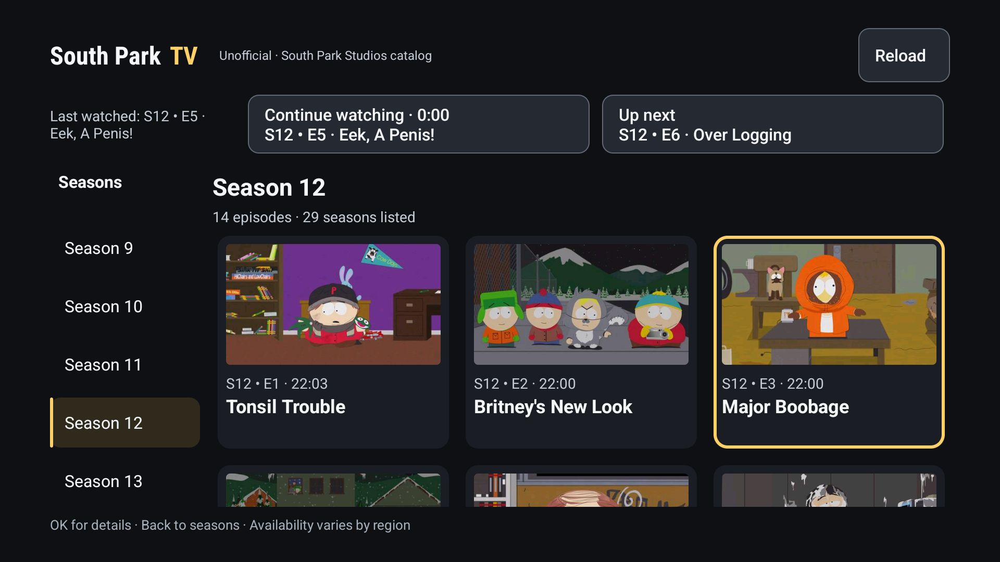

# South Park TV, unofficial

Native Android TV season and episode browsing, with native Media3 video playback using the official site's Google IMA DAI streaming sessions. No website WebView or remote pointer in the browsing/playback flow. The IMA SDK may internally use web components for its own ad functionality.

## Interface and design system

Version **0.5.1** adds smaller, soft-white text captions with a subtle shadow instead of solid black boxes. Android accessibility caption preferences still take priority. [Subtitle styling contract](docs/design-system.md).

Version **0.5.0** redesigns the native catalog, episode details and player chrome around a charcoal/amber TV system: clear focus versus selected season, readable 16:9 cards, safe-inset controls, visible Reload/Retry and restored episode focus. Existing playback/history behavior remains intact.

Shared foundations live in Android resources; `TvUi` and `EpisodeCard` provide reusable presentation. Future changes should start with [the design-system guide](docs/design-system.md) and [AGENTS.md](AGENTS.md). The [research archive](docs/design/research/README.md) records sources and alternatives, not additional feature requirements.




## App updates

Use **App updates** in the catalog to check GitHub Releases manually. See [publishing and verification](docs/auto-update.md) for signing, release assets and installation limits.

## Install

APK: `app/build/outputs/apk/debug/app-debug.apk`.

With your TV paired/connected through its documented Android debugging procedure:

```sh
adb install -r app/build/outputs/apk/debug/app-debug.apk
```

The launcher name is **South Park TV · Unofficial**. Alternatively, transfer the APK to the TV and install it with a trusted file manager after granting that file manager permission to install unknown apps.

## Regional sources

The catalog header offers English or Spanish through **Idioma**. Spanish connects to the [official Spanish catalog](https://southpark.cc.com/es/seasons/south-park), but this Mac currently receives an official redirect followed by 404. The app keeps Spanish selected with Retry and never substitutes the English catalog. Native Spanish playback and actual Latin American audio remain unverified. [Connection evidence and remaining work](docs/multiregion.md).

## Use

- Select a season in the left sidebar and press OK.
- Select an episode card and press OK, then **Watch episode**.
- All episode pages are fetched for the selected season, not just the first ten episodes.
- In the native player, OK opens playback controls, including a visible **Back to episodes** button at the top. All toolbar buttons are reachable with the D-pad.
- Video always uses **Fit**, preserving the full delivered frame with black bars when needed. There is no picture-mode button. Provider-side cropping cannot be reversed.
- Use the D-pad for transport controls, settings and captions when offered by the stream.
- Dedicated play/pause and fast-forward/rewind remote keys work. Seek increments are ten seconds. The player applies ad-related seek restrictions.
- In playback, **Back** hides the controls first. Press Back again while controls are hidden to return to episodes. The visible **Back to episodes** button returns directly. Back from the grid focuses the season list.
- Player controls show the current episode title and season/episode label. **Next episode ›** plays the next listed episode from the beginning, with a fresh official playback session. At the end of an episode, the next one starts automatically; unavailable or authentication-required entries are not bypassed.
- The visible **Reload** action is reachable using arrows alone; Menu is an optional reload shortcut. Failed catalog requests expose **Retry**. The app remembers the last season, restores the launching card after playback and resumes each episode near its saved content position.
- **Last watched** shows the most recently played episode after returning to the catalog or reopening the app. **Continue watching** resumes it. **Up next** suggests the following episode in the official catalog, including the next season when listed. Playback autoplays the next available listed episode at content end. Completed episodes offer **Watch again**.

Cards show **✓ Watched** for completed episodes. Use **Mark as watched** or **Mark as unwatched** in episode details to change this locally. Completion uses the existing final-ten-seconds rule; replaying an episode does not erase its watched mark. Captions on/off and the selected language/role persist across Next and autoplay within the current player session, when offered by the next stream.

The app lists what the official site publishes in your region. During validation it exposed 29 seasons and 331 full-episode cards across Seasons 1–28. Season 29 offered clips only, so the app displays an empty-state message for full episodes instead of inventing entries or claiming all produced episodes are available. Counts can change.

## Playback and availability

The app reads public metadata from the official site's server-rendered page data and pagination API. For playback it reads the episode's current official `videoServiceUrl`, requests a fresh `androidtv` session, and passes the supplied content source ID, video ID, authorization token and ad parameters to Google's native IMA DAI integration in Media3. It does not embed captured stream URLs or reuse browser session tokens.

The ad-aware stream includes the provider's ad flow. No ad stripping, downloads, DRM bypass, region spoofing, provider-login bypass, unofficial sources, or proxy server. If the provider requires login or an unsupported streaming/DRM setup, playback stops with an explanation and an optional external-browser fallback.

**Verified on the Android TV API 36 emulator:** the complete v0.5 regression passes Major Boobage/Canada playback, pause/resume/seek, two-stage/direct Back, manual Next, restart/Continue and natural-end autoplay into S12 E5. Actual recorded audio is non-silent (latest peak -22.1 dBFS). Player callbacks alone had previously missed a silent NullSink fallback. This does not establish every episode, ad break, caption track or physical TV. Native settings/caption menus and panel-first Back pass; one English caption track was visually checked on S12 E5. Physical-device audio/captions, DRM, ad delivery and other regions still need testing.

## Privacy

Catalog requests go to South Park Studios and thumbnail requests to Paramount. Playing an episode also contacts Paramount's playback service, Google IMA DAI and provider-selected streaming/ad infrastructure. They receive network information such as IP address and user agent. The app requests non-personalized ads, restricted data processing and limited ad tracking; these flags are not a guarantee of no provider tracking and are not fabricated consent. No consent strings are invented.

There is no app account or custom analytics service. Advertising-ID and Android AdServices permissions are removed from the merged manifest. Playback uses new random session identifiers rather than a stored advertising identifier. Local preferences hold the last selected season, per-episode resume positions, per-episode watched flags, and one last-watched entry with episode metadata, position, duration and completion state. Earlier WebView builds may leave website storage behind until app data is cleared. Artwork is cached only in memory. Clear Android app storage to remove local preferences.

The project is not affiliated with South Park, Comedy Central or Paramount. Generic original launcher artwork is used.

## Build and test

Requires Android SDK 36.1, JDK 17+ and network access to the Google/Maven repositories. On macOS with Android Studio installed:

```sh
export ANDROID_HOME="$HOME/Library/Android/sdk"
export JAVA_HOME="/Applications/Android Studio.app/Contents/jbr/Contents/Home"
./gradlew :app:assembleDebug :app:testDebugUnitTest :app:lintDebug
```

Local tests cover public metadata parsing, selected seasons with null URLs, episode cards, pagination links, clip-only seasons, authentication flags, official-page URL validation, saved history serialization, completion boundaries and next-episode selection.

With `emulator-5554` running and `ffmpeg` installed:

```sh
python3 scripts/check-design-tokens.py
ANDROID_SERIAL=emulator-5554 python3 scripts/smoke-test.py
ANDROID_SERIAL=emulator-5554 python3 scripts/check-tv-ui.py
```

The three offline design checks cover semantic text/focus contrast and app target sizes. The live UI check covers distinct season focus/selection, safe focused-card bounds, dialog focus/return, D-pad Reload without focus theft, the clip-only empty state and 1.2 font scale with animator scale zero. It changes only temporary emulator settings, restores them in `finally`, and leaves the catalog open. Screenshots/XML go to `/tmp/southpark-design-review` (override `TV_UI_ARTIFACT_DIR`). It refuses physical devices.

This live test installs the APK without clearing app data, navigates with remote keys, checks all 14 Season 12 cards including the paginated last episode, plays both supplied episodes, and verifies native video/audio callbacks plus pause/resume/seek. It tests native settings/caption panels and their Back dismissal, two-stage Back, visible Back and Next buttons, safe transport bounds, episode metadata, the removed picture toggle, caller card focus, saved history, sequential suggestions, process restart and Continue. It measures actual recorded emulator audio samples rather than relying only on Player callbacks. Finally it seeks via the normal time bar to Canada's last second and verifies autoplay into S12 E5, leaving E5 playing. Set `ANDROID_SERIAL=emulator-5554` when multiple devices are connected. The test uses current independently observed catalog counts; update its expected values if the official catalog changes.

### macOS Android TV emulator audio

**Do not disable VirtioSndCard on this ARM64 image.** The earlier suggestion removed the guest's sound card and silently sent audio to NullSink. The lack of PCM write errors did not mean sound worked.

The tested working setup uses the official stable emulator **37.2.12**, CoreAudio, host GPU, audio output enabled and microphone input disabled. It retains the default virtual sound card. The existing SDK installation was not overwritten; a checksum-verified copy was extracted separately under `/tmp/southpark-emulator-37` from [Google's SDK repository](https://dl.google.com/android/repository/repository2-3.xml).

```sh
ANDROID_HOME="$HOME/Library/Android/sdk" ANDROID_AVD_HOME=/tmp/southparktv-avds \
  /tmp/southpark-emulator-37/emulator/emulator \
  -avd SouthParkSmoke -no-snapshot -no-boot-anim -audio coreaudio -gpu host \
  -feature -HardwareDecoder
```

This uses the temporary AVD created during validation. Its `config.ini` has `hw.audioOutput = yes` and `hw.audioInput = no`. Adjust names/paths for your setup. Close only this app's existing emulator instance before relaunching it. Temporary files may disappear on reboot; update your normal SDK emulator through Android Studio for a durable installation. No global Mac sound settings were changed.

While an episode is playing, independently check its actual emulator audio output:

```sh
python3 scripts/check-emulator-audio.py
```

This records eight seconds inside the emulator, checks the waveform with FFmpeg, then deletes the temporary recording. It rejects silent output and known NullSink/hardware failures. It does not record the microphone. The latest full v0.5.1 smoke measured -22.1 dBFS; the broken configuration measured digital silence. The user subsequently confirmed audible sound.

### Emulator video cropping

The virtual hardware decoder `c2.goldfish.h264.decoder` displayed a magnified corner even in Fit mode. Disabling the emulator's **HardwareDecoder** feature selects `c2.android.avc.decoder` instead. This is separate from the virtual sound card, which must remain enabled. The full picture was visually checked at 768×432 and after a live switch to 1920×1080; audio still passes the waveform check.

The launch command above includes this fix. For the existing tested temporary setup, close only this app's running emulator and use:

```sh
bash scripts/run-tv-emulator.sh
```

Override `SOUTHPARK_EMULATOR` to use another updated emulator executable and `ANDROID_AVD_HOME`/the script's first argument for another AVD. No APK decoder restriction is added: physical TVs retain their normal hardware acceleration. [Before](docs/screenshots/corner-crop-before.png) and [after](docs/screenshots/corner-crop-after.png) show the same bedroom scene with Fit selected.

See [VALIDATION.md](VALIDATION.md) and [docs/site-protocol.md](docs/site-protocol.md) for findings and remaining limits.
